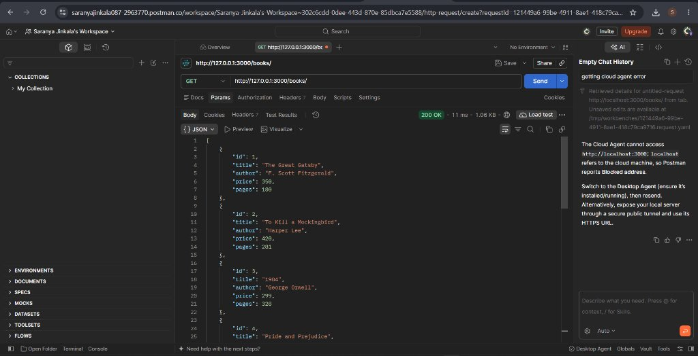
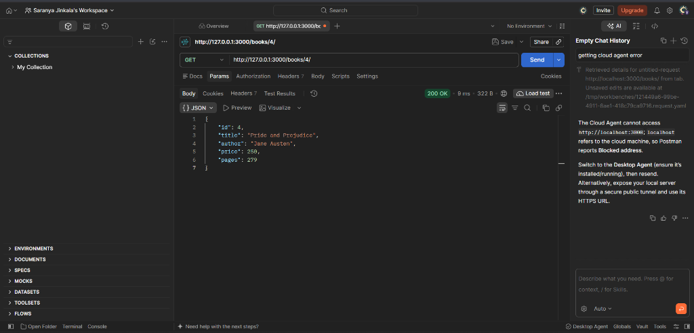
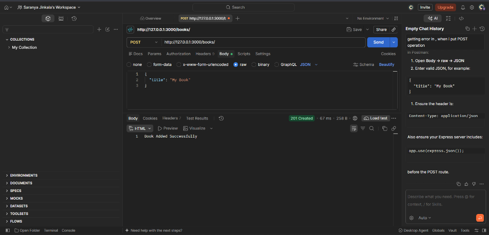
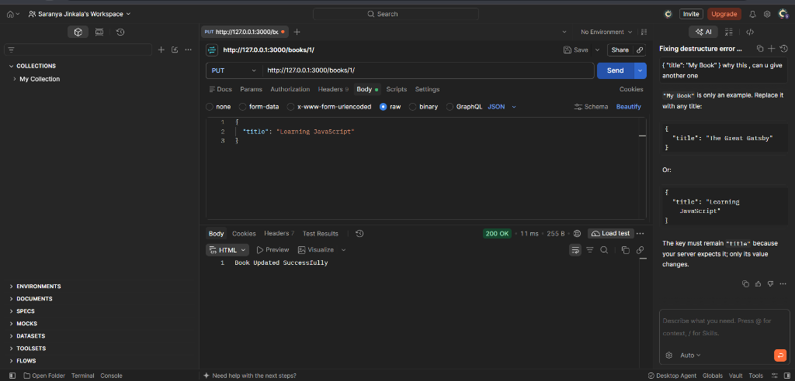
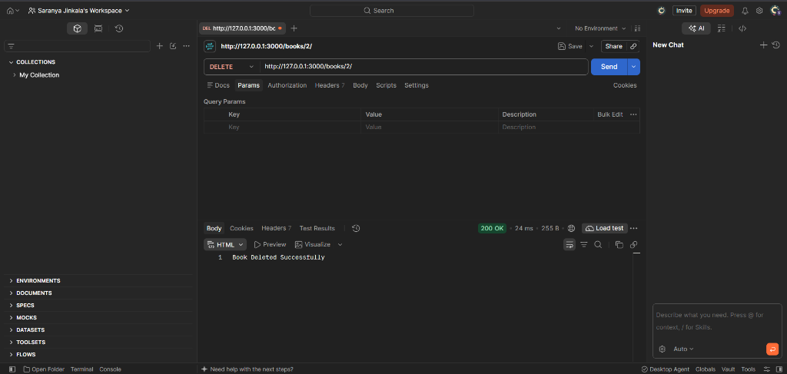

# Backend Development Fundamentals - Lab 2: SQLite Database and CRUD Routes

This repository contains the complete implementation for Lab 2: SQLite Database and CRUD Routes built using Node.js, Express.js, and SQLite.

🔗 **Repository Link:** [https://github.com/saranyajinkala087-ops/labreport2](https://github.com/saranyajinkala087-ops/labreport2)

---

## 🛠️ Tech Stack
- **Node.js**: JavaScript runtime environment
- **Express.js**: Web server framework
- **SQLite / SQLite3**: File-based relational database and driver
- **Nodemon**: Development utility for automatic server reload

---

## 🗄️ Database Schema

### Table: `book`
| Field | Type | Constraint | Description |
|---|---|---|---|
| `id` | `INTEGER` | `PRIMARY KEY` | Unique identifier (auto-incrementing) |
| `title` | `TEXT` | | Title of the book |
| `author` | `TEXT` | | Author of the book |
| `price` | `INTEGER` | | Price in currency units |
| `pages` | `INTEGER` | | Number of pages |

---

## 🚀 API Endpoints (CRUD)

| Method | Endpoint | Description | Status Code |
|---|---|---|---|
| `GET` | `/books/` | Retrieve all books | `200 OK` |
| `GET` | `/books/:bookId/` | Retrieve a single book by ID | `200 OK` / `404 Not Found` |
| `POST` | `/books/` | Add a new book | `201 Created` |
| `PUT` | `/books/:bookId/` | Update an existing book by ID | `200 OK` / `404 Not Found` |
| `DELETE` | `/books/:bookId/` | Delete a book by ID | `200 OK` / `404 Not Found` |

All database operations use **asynchronous functions (`async/await`)** and **parameterized SQL queries (`?` placeholders)** to prevent SQL injection.

---

## 📦 Getting Started

### 1. Install Dependencies
```bash
npm install
```

### 2. Initialize / Seed the Database
```bash
npm run init-db
```

### 3. Start the Server
- **Production mode:**
  ```bash
  npm start
  ```
- **Development mode (with auto-reload):**
  ```bash
  npm run dev
  ```

Server will run at: `http://localhost:3000/`

---

## 📸 Output Screenshots

### 1. `GET /books/` (Retrieve all books)


### 2. `GET /books/:bookId/` (Retrieve single book by ID)


### 3. `POST /books/` (Add a new book)


### 4. `PUT /books/:bookId/` (Update existing book)


### 5. `DELETE /books/:bookId/` (Delete book by ID)

